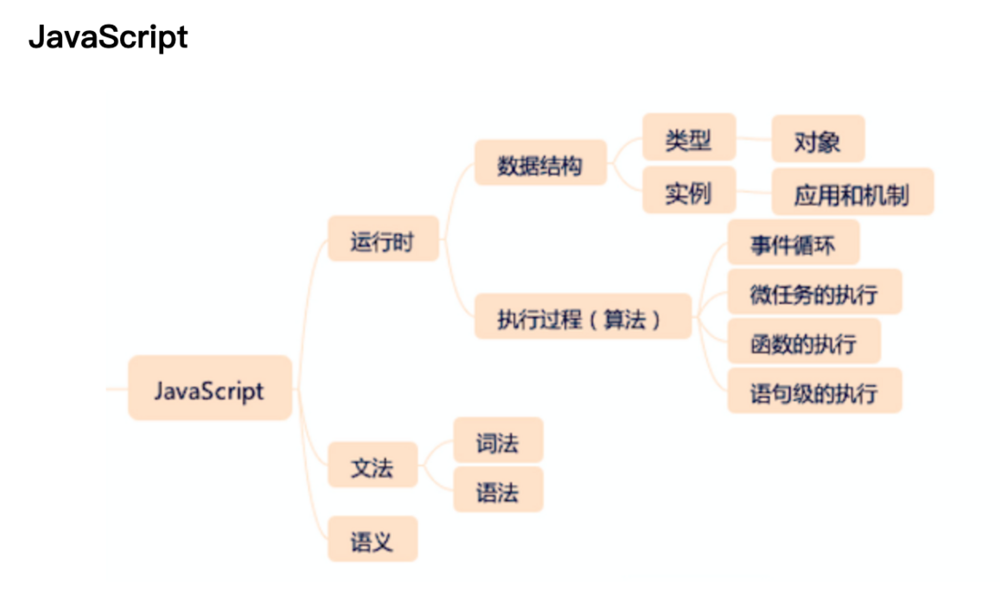
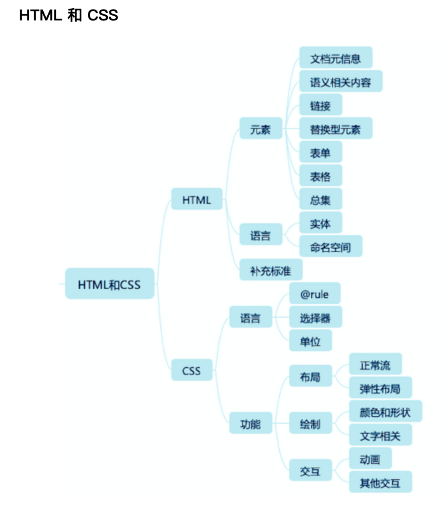
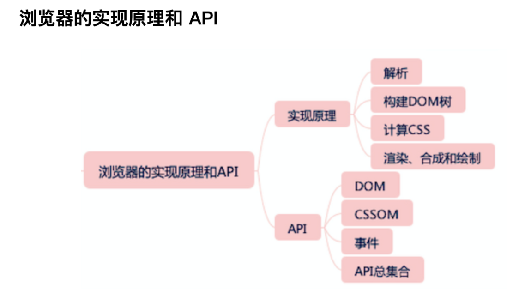
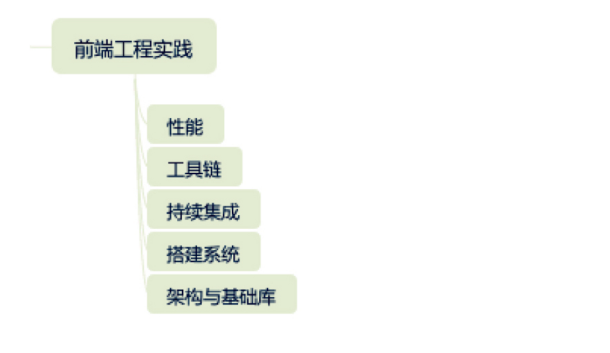

:::tip 来源
本文整理自 [SegmentFault · 【笔记】重学前端-winter](https://segmentfault.com/a/1190000018238345)
:::

# 导语：前端学习方法与知识体系

如果深入进去了解，你会发现，表面上看他们可能是一时忘记了，或者之前没注意但实际上是他们对于前端的知识体系和底层原理没有真正系统地理解

**前端学习方法：**
一是立足标准，系统性总结和整理前端知识，建立自己的认知和方法论
二是放眼团队，从业务和工程角度思考前端团队的价值和发展需要

第一个方法：建立知识架构
知识的“目录”或者索引：把零散的知识组织起来，也能够帮助我们发现一些知识上的盲区，面试时，定位到知识架构中的位置，相关点讲出

第二个方法：追本溯源
看这个出现的背景和原因，提出他是为了解决什么或者其底层是什么，其中还可以发掘一些趣闻，便于记忆

**课程目标：**
把无法通过查阅解决的原理和背景讲清楚
不方便查阅和记忆的内容整理好

**前端知识体系：**
javascript:用一定的词法和语法，表达一定语义，从而操作运行时
数据结构
1.类型：JavaScript 的类型系统就是它的 7 种基本类型和 7 种语言类型
2.实例：内置对象部分
算法：JavaScript 的执行过程

html
1.元素
文档元信息：通常是出现在 head 标签中的元素，包含了描述文档自身的一些信息
语义相关：扩展了纯文本，表达文章结构、不同语言要素的标签；
链接：提供到文档内和文档外的链接
替换型标签：引入声音、图片、视频等外部元素替换自身的一类标签...
表单：用于填写和提交信息的一类标签；
表格：表头、表尾、单元格等表格的结构。
2.把 HTML 当作一门语言来了解下：语法和语言机制
3.补充标准：ARIA，它是 HTML 的扩展，在可访问性领域，它有至关重要的作用

