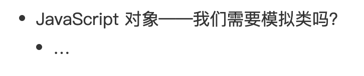
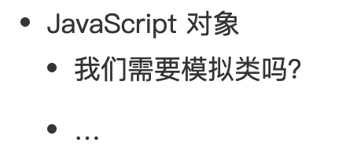
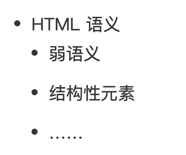

:::tip 来源
本文整理自 [SegmentFault · 【笔记】重学前端-winter](https://segmentfault.com/a/1190000018238345)
:::

# HTML 语义

**定义：**
语义类标签则是纯文字的补充,eg:标题、自然段、章节、列表，这些内容都是纯文字无法表达的
**建议：**
只靠 div 和 span 就能走天下了:用于描述“软件界面”多过于“富文本”
**好处：**
1.无css时,清晰的目录结构
2.SEO
3.读屏软件,根据文章可以自动生成目录 eg:阅读视图功能

**使用场景：**
1.作为自然语言和纯文本的补充，用来表达一定的结构或者消除歧义 eg: ruby(注释)/em(重音)
2.文章标题摘要
hgroup 标签：在 hgroup 中的 h1-h6 被视为同一标题的不同组成部分

```html
<hgroup>
<h1>JavaScript 对象 </h1>
<h2> 我们需要模拟类吗？</h2>
</hgroup>
<p>balah balah</p>
......
```



不加hgroup


section 的嵌套会使得其中的 h1-h6 下降一级,HTML5之后，只需要 section 和 h1 就足以形成文档的树形结构

```html
<section>
    <h1>HTML 语义 </h1>
    <p>balah balah balah balah</p>
    <section>
        <h1> 弱语义 </h1>
        <p>balah balah</p>
    </section>
    <section>
        <h1> 结构性元素 </h1>
        <p>balah balah</p> 
    </section>
......
</section>
```



3.适合机器阅读的整体结构
“阅读模式”，以及各种非浏览器终端的出现

```html
<body>
    <header>
        <nav>
            ……
        </nav>
    </header>
    <aside>
        <nav>
            ……
        </nav>
    </aside>
    <section>……</section>
    <section>……</section>
    <section>……</section>
    <footer>
        <address>……</address>
    </footer>
</body>
```

article，报纸的多文章结构适合用 article 来组织，article为独立性质文章，article与body有相似结构，也可包含header/footer
header，如其名，通常出现在前部，表示导航或者介绍性的内容
footer，通常出现在尾部，包含一些作者信息、相关链接、版权信息
aside 表示跟文章主体不那么相关的部分，它可能包含导航、广告等工具性质的内容
