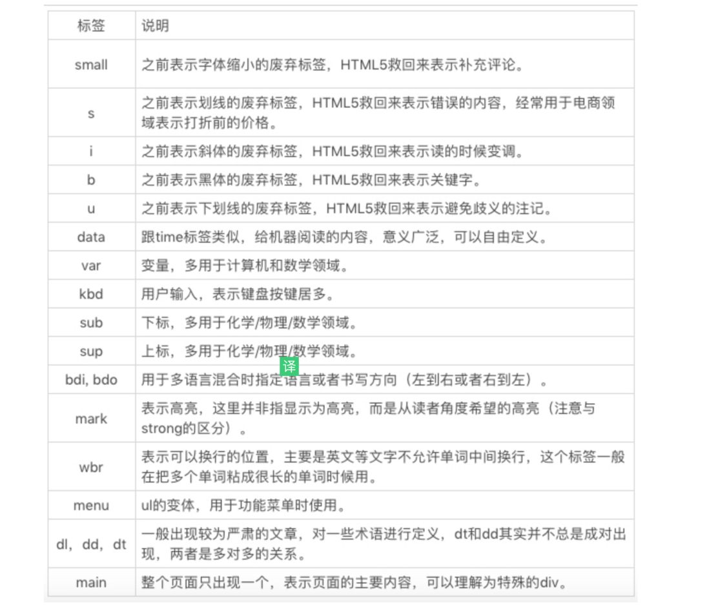

:::tip 来源
本文整理自 [SegmentFault · 【笔记】重学前端-winter](https://segmentfault.com/a/1190000018238345)
:::

# HTML 语义：如何运用语义类标签呈现 Wiki 网页

**实现如下wiki网页需要的标签：**
[https://en.wikipedia.org/wiki...](https://link.segmentfault.com/?enc=cJns1JYqZXcX%2F8LUNkuLuw%3D%3D.k9434bVSr6Q4JVNTVVIeNJV3gH4ieU2asFs2pp1KAoRNfDuUOCYS4jkztgH7o2z3)
aside: 左侧侧边栏/导航性质的工具内容
article: 独立为文章主体
abbr 标签表示缩写
hr 表示故事走向的转变或者话题的转变
strong 重要，黑体
blockquote, q, cite： blockquote 表示段落级引述内容，q 表示行内的引述内容，cite 表示引述的作品名。
time 机器阅读方便
figure, figcaption 表示与主文章相关的图像、照片等流内容
dfn 被包裹的名词
pre 不需要浏览器帮我们做自动换行，不需要浏览器进行排版。
samp 计算机程序的示例输出
code 代码

**除上面用到的标签之外，还需要用到：**

