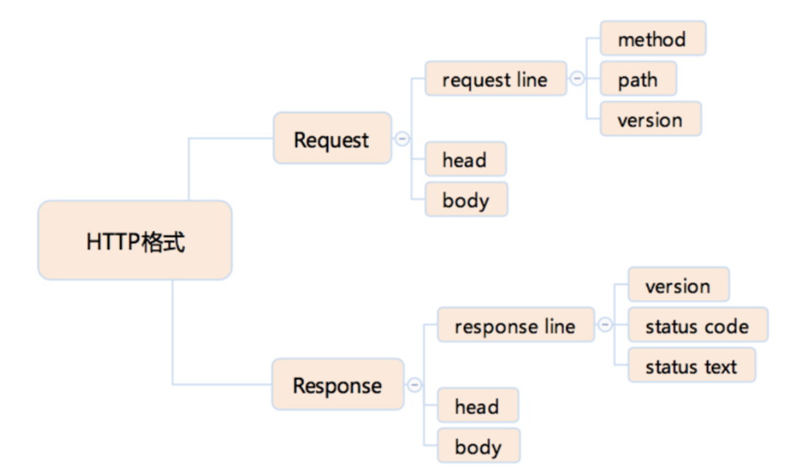
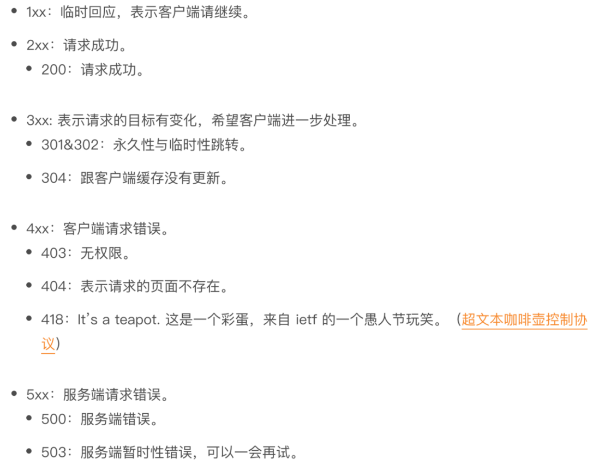
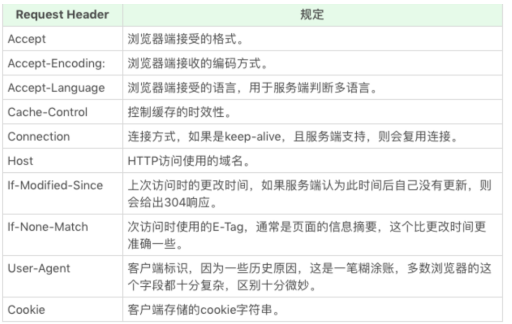
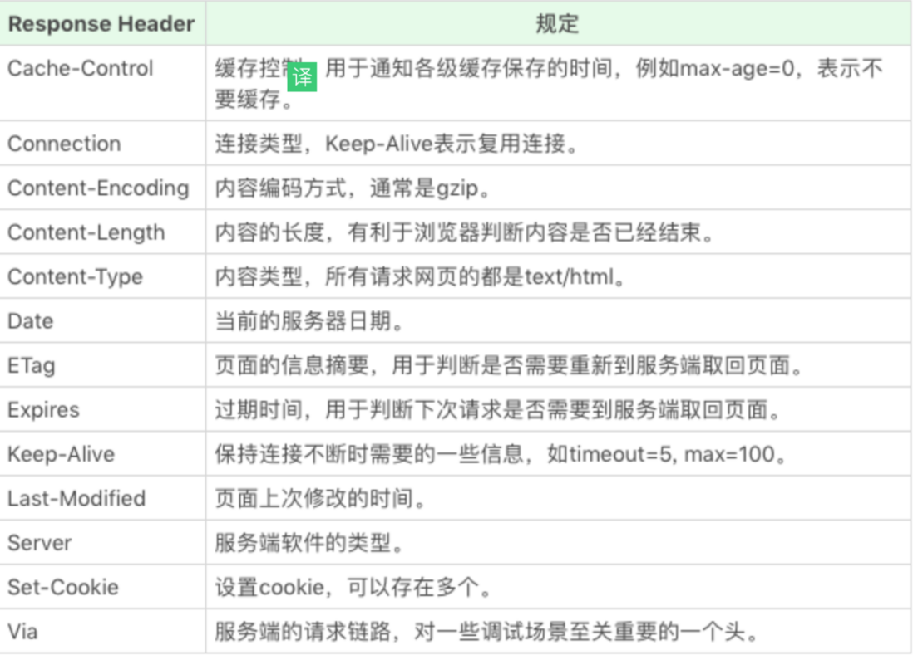
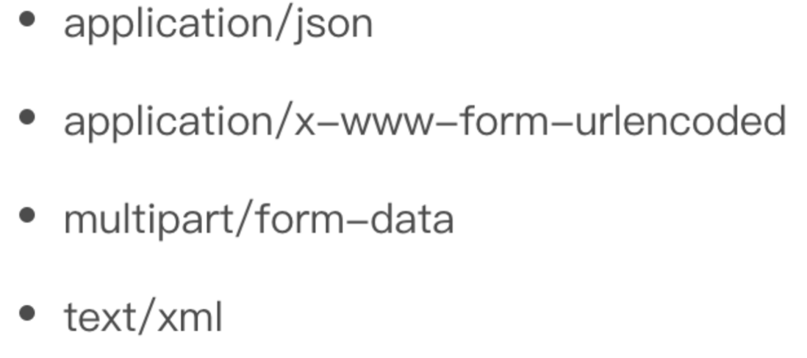

:::tip 来源
本文整理自 [SegmentFault · 浏览器：一个浏览器是如何工作的？（阶段一）](https://segmentfault.com/a/1190000018920090)
:::

# 浏览器是如何工作的（一）：HTTP

### 浏览器 - HTTP

- 简介：HTTP 在 TCP 的基础上，规定了 Request-Response 的模式, 纯粹的文本协议,定了使用 TCP 协议来传输文本格式的一个应用层协议。
- 协议格式

### HTTP Method（方法）

GET POST HEAD PUT DELETE CONNECT OPTIONS TRACE

- 通过地址栏访问页面都是 GET 方法。表单提交产生 POST
- HEAD 则是跟 GET 类似，只返回请求头，多数由 JavaScript 发起
- PUT 和 DELETE 分别表示添加资源和删除资源，语义资源并非强约束
- CONNECT 现在多用于 HTTPS 和 WebSocket
- OPTIONS 和 TRACE 一般用于调试，多数线上服务都不支持

- HTTP Status code（状态码）和 Status text

- 304: 客户端本地已经有缓存的版本，并且在 Request 中告诉了服务端，当服务端通过时间或者 tag，发现没有更新的时候，就返回一个不含 body 的 304 状态。
- 实际上 301 更接近于一种报错，提示客户端下次别来了
- 1xx 的状态被浏览器 http 库直接处理掉了，不会让上层应用知晓

### HTTP Head (HTTP 头)

- 请求头

-响应头

### HTTP Request Body

常见body格式

form标签：默认会产生 application/x-www-form-urlencoded，当有文件上传时，则会使用 multipart/form-data

### HTTPS

- 作用：一是确定请求的目标服务端身份，二是保证传输的数据不会被网络中间节点窃听或者篡改。
- 区别：使用加密通道来传输 HTTP 的内容，TLS 构建于 TCP 协议之上，它实际上是对传输的内容做一次加密，所以从传输内容上看，HTTPS 跟 HTTP 没有区别

### HTTP 2.0

- 改进：一是支持服务端推送，二是支持 TCP 连接复用   提前把一部分内容推送给客户端，放入缓存当中，这可以避免客户端请求顺序带来的并行度不高，从而导致的性能问题。   同一个 TCP 连接来传输多个 HTTP 请求，避免了 TCP 连接建立时的三次握手开销，和初建 TCP 连接时传输窗口小的问题。

### 补充知识

- DNS查询得到IP
- tcp/ip的并发限制
- get和post的区别 我的总结: [https://segmentfault.com/a/11...](https://segmentfault.com/a/1190000018887962)
- 五层因特网协议栈
- 长连接与短连接
  - TCP就是数据传输的通道(先建立通道再传输数据，能够保证安全)
  - TCP保活功能：为服务器应用提供，服务器应用希望知道客户主机是否崩溃
- http2.0与http1.1的显著不同点：
- 强缓存与协商缓存
