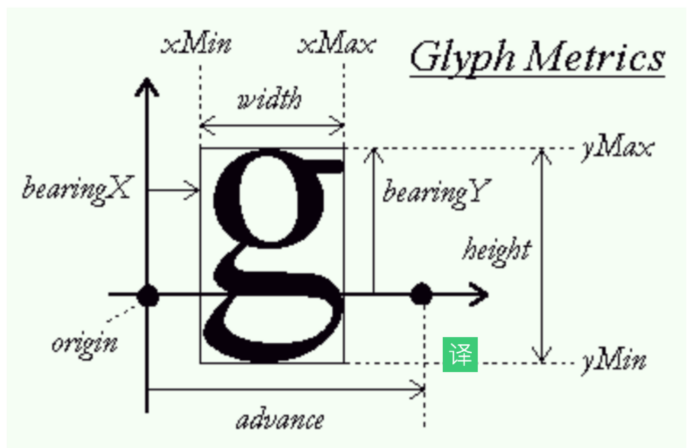
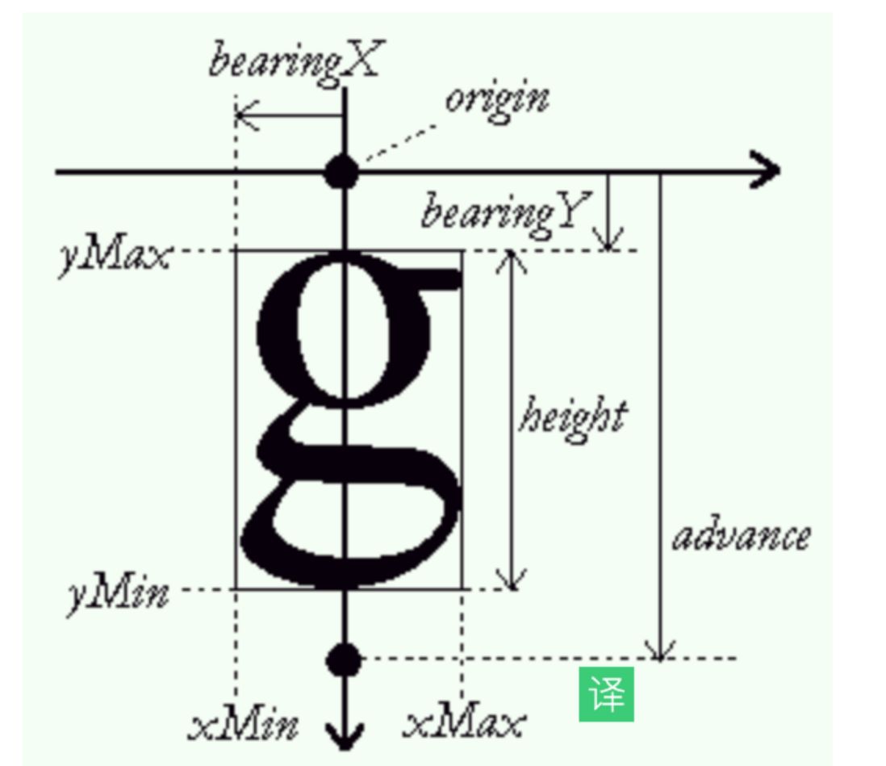

:::tip 来源
本文整理自 [SegmentFault · 浏览器：一个浏览器是如何工作的？（阶段四）](https://segmentfault.com/a/1190000018932362)
:::

# 浏览器是如何工作的（四）：排版

### 基本概念

- 排版：把浏览器确定元素位置的过程
- 分类：正常流中的文字排版、正常流中的盒、绝对定位元素、浮动元素排版、flex 排版、表格相关排版、grid 排版
- 正常流排版：它包含了顺次排布和折行等规则，跟我们平时书写文字的方式一致
- 文字排版：它规定了行模型和文字在行模型中的排布，行模型规定了行顶、行底、文字区域、基线等对齐方式。(英语本：四条线就是一个简单的行模型）
- 盒模型：素被定义为占据长方形的区域，还允许边框、边距和留白(浏览器为支持元素和文字的混排)
- 绝对定位元素：把自身从正常流抽出，直接由 top 和 left 等属性确定自身的位置，不参加排版计算，也不影响其它元素。绝对定位元素由position 属性控制
- 浮动元素：自己在正常流的位置向左或者向右移动到边界，并且占据一块排版空空间。浮动元素由 float 属性控制。
- 这些排版方式由外部元素的 display 属性来控制（注意：display 同时还控制元素在正常流中属于 inline等级还是 block 等级）

### 正常流

详细正常流排版的行为查阅24讲

正常流是唯一一个文字和盒混排的排版方式

### 正常流文字排版

- 正常书写文字：是从左到右依次书写，每一个字跟上一个字都不重叠，文字之间有一定间距，当写满一行时，我们换到下一行去继续写，书写中文时，文字的上、下、中轴线都对齐，书写英文时，不同字母的高度不同，但是有一条基线对齐(浏览器类似)
- 浏览器特点：还支持改变排版方向
  - 文字依次书写的延伸方向称为主轴
  - 换行延伸的方向，跟主轴垂直交叉，称为交叉轴
- 开源字体解析库 freetype
  - advance：每一个文字排布后在主轴上的前进距离，它跟文字的宽 / 高不相等
  - 文字排版还受到一些 CSS 属性影响：line-height(行高)、letter-spacing(字母间距中文字和英文字母)、word-spacing(单词间距：英文单词，中文无作用)
  - 横向：

- 纵向：

### 正常流中的盒元素排版

- display 不为 inline 的元素或者伪元素，会以盒的形式跟文字一起排版
- display 属性都可以分成两部分：内部的排版和是否 inline，带有 inline- 前缀的盒，被称作行内级盒。
- 盒模型在主轴方向占据的空间是由对应方向的这几个属性之和决定的(margin、border、padding、width/height 等属性）
- 浏览器排版
  - inline行的排版：先行内布局，再确定行的位置，根据行的位置计算出行内盒和文字的排版位置
  - block块级盒: 单独占据一整行，计算出交叉轴方向的高度即可

### 绝对定位元素

- position 属性为 absolute 的元素
- 其父级的 position 非 static 元素的包含块来确定位置

### 浮动元素排版

- 浏览器对 float 的处理：先排入正常流，再移动到排版宽度的最左 / 最右（这里实际上是主轴的最前和最后）
- 移动之后，float 元素占据了一块排版的空间，因此，在数行之内，主轴方向的排版距离发生了变化，直到交叉轴方向的尺寸超过了浮动元素的交叉轴尺寸范围，主轴排版尺寸才会恢复
- float 元素排布完成后，float 元素所在的行需要重新确定位置

### flex排版和其他排版

- CSS 的每一种排版都有一个很复杂的规定，都有对应的标准
- flex 排版，支持了 flex 属性，flex 属性将每一行排版后的剩余空间平均分配给主轴方向的 width/height 属性

### 不同排版混用

- 关系复杂，winter不过多赘述
- 遵守可以内外嵌套、但是不混用的规则即可

### 总结

这节我可以理解为正常流的排版方式，里面的文字元素的排版，盒元素的排版，以及定义为绝对元素，浮动元素的排版。
