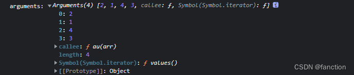

:::tip 来源
本文整理自 [SegmentFault · 暂时性死区以及函数作用域](https://segmentfault.com/a/1190000043450727)
:::

# 暂时性死区与函数作用域

### 暂时性死区

暂时性死区也就是变量声明到声明完成的区块，这个区块是一个封闭的作用域，直到声明完成。
如果在变量声明之前使用该变量，那么该变量是不可用的，也就被称为暂时性死区。

- `var` 没有暂时性死区，因为`var`存在变量提升
- `let、const`有块级作用域，没有变量提升，存在暂时性死区

```js
console.log(a); // 报错 Cannot access 'a' before initialization
let a = '东方不败' 
```

```js
console.log(b); // 报错 Cannot access 'b' before initialization
const b = '东方不败'
```

```js
console.log(c);   // undefined 因为var存在变量提升
var c = '东方求败'  
```

`ES6`规定，如果代码块中存在`let`和`const`命令声明的变量，这个区块对这些变量从一开始就形成了封闭作用域，直到声明语句完成，这些变量才能被访问（获取或设置），否则会报错`ReferenceError`。这在语法上称为“暂时性死区”（英temporal dead zone，简 TDZ），既代码块开始到变量生命语句完成之前的区域。

---

### 函数作用域

**案例一**
一旦设置了参数的默认值，函数进行生命初始化时，参数就会形成一个单独的作用域，等初始化结束，这个作用域就会消失，这种语法在不设置参数默认值时不会出现。

```js
var x = 1
function f(x,y = x){
     console.log(y);
    }
f(2)  // 2
```

上面这个例子中，函数参数这里`（x,y = x）`，这个区域就是单独的作用域，`y`默认的`x`变量指向第一个参数`x`，而不是全局变量`x`，这里调用f函数，向`x`传递数值`2`，`y = x` 那么 `y = 2`，打印结果为`2`

**案例二**

```js
let x2 = 1
function f2(y2 = x2){
         let x2 = 2
         console.log(y2);
     }
f2()  // 1
```

调用`f2`函数，由于未给`f2`函数任何参数，并且 `y2 = x2` 形成一个单独的作用域，在这个作用域里`x2`并未定义，所以`x2`指向的是外层全局变量`x2`，`y2 = x2` 也就是`y2 = 1`，在这里，函数内部的`x2`并未起到任何作用。

>

```js
// 报错
function f2(y2 = x2){
         let x2 = 2
         console.log(y2);
     }
f2()  // 报错
```

上面的例子中，如果去掉全局变量`x2`则会报错，因为变量未声明，给`y2`赋值了一个未声明的变量，报错。

```js
var xx = 1
function fxx(xx = xx){
    console.log(xx);
    }
fxx()
```

上面这个写法也会报错，由于函数的参数存在单独的作用域，在这个参数作用域内，执行结果为 `let xx = xx`，给`xx`赋值一个未声明的变量`xx`报错。(暂时性死区）

如果函数的默认参数是函数，该函数的作用域也要遵循这个规则。

```js
let foo = 'out'
function bar(func = () => foo){
      let foo = 'come'
      console.log(func());
  }
bar()  // out
```

这个例子中，函数的参数是`func`默认值是一个匿名函数，返回值为变量`foo`，由于函数参数这里形成一个单独的作用域，在这个作用域里面并没有定义变量`foo`，所以`foo`会指向外层全局变量`foo`。如果去掉全局变量`foo='out'`报错，赋值了一个未声明的变量。

**应用**
可以利用这个特性写一个参数默认值错误抛出，如果参数并未传参则抛出一个错误。

```js
function throwErr(){
    throw new Error('参数不得省略')
    }
    
function omits(mustfn = throwErr()){
    return mustfn
    }
omits(); // 未传参抛出错误 ： 参数不得省略
```

调用`omits`函数未传参数，该函数就会默认调用`throwErr()`函数并抛出错误。

>---

### rest参数

**arguments**
`arguments`可以获得函数的参数值以及函数信息（`name、length`）等

```js
    function au(arr){
        console.log('arguments:',arguments);
    }
    au(2,1,4,3)
```



可以通过数组方法对函数参数进行操作，例如排序。
`arguments`对象不是数组，而是一个类似数组的对象，为了使用数组的方法，必须使用`Array.from`先将其转为数组。

```js
function au(arr){
     // 通过数组方法对函数参数进行排序
     return Array.from(arguments).sort();
   }
console.log(au(2,1,4,3))  // [1,2,3,4]
```


**rest参数**
`ES6`提供了`rest`参数，语法：(`...变量名`），其实就是剩余运算符，通过`rest`参数就可以很容易的对函数参数进行操作，并且`rest`的参数是一个真正的数组。

```js
// resy参数(剩余运算符)
function residue(...val){
      console.log(val);  // [1,2,3]
    }
residue(1,2,3)
```

`rest`参数(剩余运算符)`只能放到最后一位`，否则报错

```js
// function residue2(...val,b){}  // 剩余运算符不是最后一位，报错
function residue3(c,...val){
  console.log(c,val);  // 1 [2,3,4,5] 
 }
residue3(1,2,3,4,5)
```

上面`arguments`完成的参数排序，使用`rest`可以很轻松的做到，并且语义更强，更方便阅读。

```js
let au2 = (...val) => val.sort()
console.log(au2(2,1,4,3));  // [1, 2, 3, 4]
```

---

### 严格模式

`ES5`开始，函数内部可以设定为严格模式： `function s(){ 'use strict'// 严格模式 }`

```js
// es5严格模式
function s(){
   'use strict'   // 严格模式
   // 代码.....
}
```

`ES6`做了修改，规定只要函数参数使用了默认值、解构赋值、扩展运算符，那么函数内部就不能显示设定为严格模式，否则报错。

```js
// es6严格模式  报错，因为设置了函数默认值
function s2(a,b = a){
   'use strict'
   // 代码.....
}
```

```js
// 报错，使用了解构赋值
const s3 = function({a,b}){
    'use strict'
}
```

```js
// 报错，使用了剩余运算符
const s4 = (...a) => {
    'use strict'
}
```

`es6`这样设置的原因是，函数内部的严格模式应该同样适用于函数体和函数参数，但是，函数执行的时候会先执行参数，再执行函数体，这样就有一些不严谨的情况，只有函数体中才能知道参数是否应该以严格模式执行，但是函数的参数确是先执行，所以`es6`修改了函数参数关于严格模式的行为。

```js
function s5(val = 070){
    'use strict'
    return val
}
s5()  // 报错
```

这一段，函数的默认值是八进制`070`，严格模式下不能使用前缀`0`表示八进制，所以报错。
但`实际上`是因为函数设置了默认参数的原因，函数先执行参数，再进函数体，由于`es6`限制，报错。

**有两种方法可以规避这种限制**
**第一种：设置全局严格模式**

```js
'use strict'
function s6(val = 100){
  console.log(val);
}
s6()  // 100
```

**第二种方法：把函数嵌套在一个无参数的立即执行函数里**

```js
const s7 = () => {
     'use strict'
     let a;
     return (function(val = 200){ return val })()
}
console.log(s7());
```

>---

案例源码：[https://gitee.com/wang_fan_w/es6-science-institute](https://link.segmentfault.com/?enc=57alRcgo3MCihmAsNnxl0g%3D%3D.OTTptInG4u6C3RhqIr%2BXSyZcefsYEcEIatv%2BxXMdbqkvOnjYsn9z2bwy7hVYaMSL%2BKJwuuU6tpk8vqKglTxksA%3D%3D)

如果觉得这篇文章对你有帮助，欢迎点亮一下star哟
