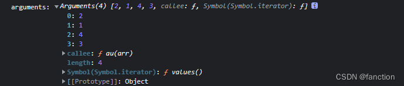

:::tip 来源
本文整理自 [SegmentFault · 微信小程序登录流程与实现](https://segmentfault.com/a/1190000043588783)
:::

# 微信小程序登录流程与实现

在了解小程序登录之前，请大家先了解小程序的全局实例和全局组件，以方便理解本文的后续内容，已经了解的可以直接开始。
[全局实例和全局组件](https://link.segmentfault.com/?enc=T1c5DD3dF5EGSwJBBtjVKg%3D%3D.zSxFNXI6tKlyHXm52dFiiqT6AVEtWviq%2BXlUtpyotj9oA1yz%2FtJZOGYapZZRC%2FmQfoZV7Y%2FzxgXb%2FCfHJrra2w%3D%3D)（ 👈 点击直达）

### 微信小程序的登录流程



### 微信小程序的登录

首先需要写一个微信小程序的登录弹窗，登录弹窗的作用就是发起登录，让用户点击授权后登录小程序，该弹窗是一个全局弹窗，因为小程序是有分享功能的，如果新用户是从分享的链接进来的，那么会先让新用户登录再做后续操作。
所以，登录功能得是一个组件，而且，登录必须是全局弹窗。
在登录页面的`index.json`文件中，设置登录弹窗为组件

```
{
  "component": true,
  "usingComponents": {
     // xxxx.....
  }
}
```

>用户勾选授权后，点击登录。  小程序登录需要使用 `button` 组件，将`button`组件的 `open-type` 的值设置为 `getPhoneNumber`，当用户点击并同意之后，可以通过 `bindgetphonenumber` 事件回调获取到动态令牌`code`，然后把`code`传到开发者后台，并在开发者后台调用微信后台提供的 `phonenumber.getPhoneNumber` 接口，消费`code`来换取用户手机号。并且每个`code`有效期为`5`分钟，且只能消费一次。
[open-type="getPhoneNumber"使用文档](https://link.segmentfault.com/?enc=nWpjFkzt9mCa8QnxrpDgPQ%3D%3D.PUF%2B7HdqfatHYsYsjDgZT7w97dbU3F%2FMBFHG6VKwVtnAETDjPJ47a1WfOJ8BBQYk2Oc1FqCxwCP%2FSHlD1gYiHGBAy7zQ1Eth8QofqDfGtb%2BMQVIQVGTKBBUPZxGcfLkbswUIMiq7Pzxowlxb82bSz5BhZOTt8Suro7jjNp%2FwVMYk%2BJIRoTaC2fctYDTlLE01WTLXFhEXwxZYs5UO69I4Hw%3D%3D) （ 👈 点击直达）

>

```html
<button open-type="getPhoneNumber" bindgetphonenumber="handleConfirm"></button>
```

```js
  data: {
    show: false,     // 登录弹窗是否显示
    selected: true,  // 是否勾选授权
    loginSuccess: undefined,
    loginFail: undefined,
  },
  
    // 确认授权手机号-这里可以做节流操作，防止用户点击次数过多，为了便于演示，这里未做节流
    async handleConfirm(data) {
      const {selected} = this.data
      // 用户未勾选，提示请勾选
      if(!selected){
        wx.showToast({
          title: '请同意《用户隐私协议》',
          icon: 'none'
        })
        return
      }
      // data.detail.code就是获取手机号的动态令牌
      let info = data.detail
      let fail = this.data.loginFail
      if (info.code) {
        // info.code就是手机号动态令牌
        
        /**新版本微信小程序不需要提前调用wx.login进行登录，这里的写法是为了实配老版本，在获取手机号授权登录之前先调用wx.login
           这里的app.globalData.userInfo为全局挂载的userInfo，关于userInfo的解释在本文下方
        */
        /* 使用awiat阻塞进程 */
        await app.globalData.userInfo._getLoginCode()  // wx.login登录
        // 调用了wx.login后进入下一步
        
        this.setPhoneInfo(info)  // 绑定手机号-获取手机号授权用户登录功能
      } else {
        fail && fail(info)
      }
    },
    

// 绑定手机号-获取手机号授权用户登录功能
setPhoneInfo(data) {
  let success = this.data.loginSuccess
  let fail = this.data.loginFail
  // data.jsCode保存通过login获取的code
  data.jsCode = app.globalData.userInfo.code
  // 手机号动态令牌
  data.phoneCode = data.code 
  // 调用用户登录接口，removeNull其实是一个封装的方法， 用来去掉空格，本质就是传了一个data
  getLoginSession(removeNull(data)).then(async res => {
    // then为登录成功，存入token
    wx.setStorageSync('token', res.data)
    // 手机号授权算登录成功
    success && success()
    // 设置全局userInfo属性,isLogin = true，表示登录成功
    app.globalData.userInfo.isLogin = true
    // 清除等待列表
    wx.queue.asyncExe("login_back")
    // 调用全局的_getUserInfo方法,传入'login'参数
    await app.globalData.userInfo._getUserInfo('login')
    // 关闭弹框
    this.hideLogin()
  }).catch(async e => {
    if (e.data.indexOf("已绑定") > -1) {
      success && success()
      wx.setStorageSync("token", e.data)
      await app.globalData.userInfo._getUserInfo('login')
    } else {
      fail && fail()
    }
    // 关闭弹框
    this.hideLogin()
  })
  },

// 关闭弹框
hideLogin() {
      // 关闭弹框
      this.setData({
        show: false
      }, () => {
        if (isPopup()) {
          // 显示tabbar()
          setTimeout(() => {
            this.getTabBar().show()
          }, 300)
        }
      })
 },
```

旧版本的微信小程序是需要提前调用`wx.login`获取`code`才能进行下一步操作，而新版本则不需要提前调用`wx.login`进行登录。

[wx.login文档](https://link.segmentfault.com/?enc=cSujVPCdkXzo5BsNguP2IA%3D%3D.eJZR6Wu8Gmb1Gki2apCeXbd2152xqZPW3LqxITLLvPCQ1ocC8kWlAls0FT9%2FWM7KRo7c%2Fz%2FjvY8EpSFxuUyatMU9Kf0E2MXhqPkVubcT%2Fq%2F2cT3hgFSyLu4h3Wx0g9AS) （ 👈 点击直达）

下面是`userInfo.js`文件，该文件内部创建了一个`class`类，该类会挂载到全局实例身上

```js
// userInfo.js
import {
  getUserInfo
} from '../service/user'
class UserInfo {
  code = '' // 用户授权登录时需要用到的code
  isLogin = false // 判断用户是否已经登录拿到token
  isInfo = false  // 判断用户是否已经登录了

  /**
   * 获取用户信息
   */
  _getUserInfo(type) {
    return new Promise((resolve,reject)=>{
      // isInfo初始化为false，表示未登录过，如登录过isInfo = true,如果登录过则直接获取本地的token
      if(type=="login"&&this.isInfo) return resolve(wx.getStorageSync('userInfo'))
      this.isInfo = true
      // 调用获取用户信息的接口
      getUserInfo().then(res=>{
        // 如果返回200，拿到token以后，保存用户的信息，主要是名称和头像
        if (res.code == 200) {
          // 保存用户信息到本地
          wx.setStorageSync('userInfo', res.data)
          // resolve返回
          resolve(res)
        }
        // 不等于200 isInfo = false，表示已经登录过，重新获取即可
        this.isInfo = false
        // 不等于200 返回错误信息
        reject(res)
      },(err)=>{
        // 不等于200 isInfo = false，表示已经登录过，重新获取即可
        this.isInfo = false
        // 不等于200 返回错误信息
        reject(err)
      })
    })
  }

  /**
   * 通过wx.login获取code
   * 不全局调用，每次授权调用Login方法前，都重新获取一次
   */
  async _getLoginCode() {
    try {
      const loginCodeRes = await wx.p.login()
      console.log(loginCodeRes)
      /**loginCodeRes.code : 用户登录凭证（有效期五分钟）。开发者需要在开发者服务器后台调用 code2Session，使用 code 换取 openid、unionid、session_key 等信息 */

      // 将该code挂载到全局的global.userInfo中
      this.code = loginCodeRes.code
    } catch (error) {
      console.error(error, 'get jscode error');
    }
  }

}

export default UserInfo
```

```js
// app.js
import UserInfo from './private/UserInfo'

App({
  /** 小程序生命周期，全局调用一次onLaunch */
  onLaunch(e) {
    /**new UserInfo() */
    this.globalData.userInfo = new UserInfo()
  },

  onShow(e) {},
  
  globalData: {
    userInfo: null,   /**private -> UserInfo的属性和方法挂载到这里 */
    show:false
  }
})
```

---

### 流程总结

通过`getPhoneNumber`的方式登录

1、`components`中创建`auth`文件夹，该文件夹就是内的`html`就是小程序的登录弹窗，`auth`是一个全局组件，在`app.json`中挂载

2、在`private`文件夹中封装小程序的登录方法 ——> `UserInfo.js` ——> `js`文件内创建`class`类，在`class`中`封装方法并导出`

3、在`app.js`的`onLaunch`中`new UserInfo` 获取之前封装好的小程序登录方法，该方法挂载到`globalData.userInfo`中

```js
import UserInfo from './private/UserInfo'
App({
    onLaunch(e){
        this.globalData.userInfo = new UserInfo()
    }
})
```

4、`auth`文件夹为小程序的全局授权登录弹窗，从基础库 `2.21.2` 开始，对获取手机号的接口进行了安全升级，新版小程序需要用户自动触发才能获取手机号接口，需用 [button](https://link.segmentfault.com/?enc=9y6J2II38KWvpqZBtiku%2Bw%3D%3D.iRa1YFikDFdzUiG8w9l24%2Brpxb7FmLh%2FxkR%2FVnivSTV8E6kJpOIQGp6IYDnaArh%2BP3C3I2TQNzOH4TSsb65TsxXu5Cx12jdYGgYba8EsYpM%3D) 组件的点击来触发。新版小程序不再需要提前调用`wx.login`进行登录

```html
<button open-type="getPhoneNumber" bindgetphonenumber="getPhoneNumber"></button>
```

```js
Page({
  getPhoneNumber (e) {
    console.log(e.detail.code)  // 该code就是动态令牌，用于换取用户手机号
  }
})
```

需要将 [button](https://link.segmentfault.com/?enc=SqclP%2BEouJgH7Qwxj2fjpA%3D%3D.%2FBFzS8TmbkPFqwKM9oGDmYQKtg%2BiifzMrcZrt%2BZodbaNe5%2BxGDcUcLlcBjKIbzNSTtodL4w%2FKS84MDB3v9XM7VXD3DW2h8zMpq2zGfNNl6Q%3D) 组件 `open-type` 的值设置为 `getPhoneNumber`，当用户点击并同意之后，可以通过 `bindgetphonenumber` 事件回调获取到动态令牌`code`，然后把`code`传到开发者后台，并在开发者后台调用微信后台提供的 [phonenumber.getPhoneNumber](https://link.segmentfault.com/?enc=nLo2jlxNV6BYEpdzEgaoag%3D%3D.a4nBhlsodVDfVIa1J5oHpDXeYh2zb3705uNfNHvHICupgLHMQX6rZJeKjL%2BL7MO9uTxE2t3PQSeuP%2BbGSs9Mt0b6ap6FVvkhGPTP7DQ9k%2BWjgCMCsqReyHvMIvvH7k1l3GlVGvf0I77y6VhHrl5sr17qRv1muQjuNVfWRVz0fmA%3D) 接口，消费`code`来换取用户手机号。每个`code`有效期为5分钟，且只能消费一次。

>5、用户点击弹框后，先让用户勾选协议，勾选后才允许点击登录，调用登录接口，将登录接口单独封装起来，将获取到的`code`手机号动态令牌当参数传入登录方法。

> 新版本微信不许要提前调用`login`来获取`code`码，旧版本微信小程序是需要提前调用`login`获取`code`码>> 为了演示，所以这里提前调用 `wx.login` 来获取`code`码，并将该`code`码存入全局`app.globalData.userInfo`中，需要注意的是，该`code`码的有效期是`5分钟`>>6、调用登录方法， 携带`code`手机号动态令牌和接口规定的必传参数，请求登录接口，返回`200`为登录成功，

```
1)、将登录成功的token存入本地
    
2)、设置全局属性app.globalData.userInfo.isLogin = true表示登录成功
    
3)、清除等待列表
```

7、调用获取用户信息接口，也就是全局挂载的`await app.globalData.userInfo._getUserInfo()`，关闭登录弹框

```js
await app.globalData.userInfo._getUserInfo('login')
```

8、获取用户信息接口，通过传入的参数判断是是否要登录，这里有两种情况：

```
1)、用户已经登录了，只是想重新获取一下token
    
2)、用户第一次登录，要获取用户信息，例如头像、用户名称
```

根据这两种情况，传入的参数`"login"`当然是不够的，所以需要再加一个状态，`isInfo`，`isInfo`默认为`false`

```js
  /**
   * 获取用户信息
   */
  _getUserInfo(type) {
    return new Promise((resolve,reject)=>{
      // 用户登录过
      if(type=="login"&&this.isInfo) return resolve(wx.getStorageSync('userInfo'))
        
      // 设置isInfo = true，因为下面要走获取用户信息流程，获取后，第二次调用_getUserInfo判断isInfo = true,直接return掉
      this.isInfo = true
      // 调用获取用户信息的接口
      getUserInfo().then(res=>{
        // 如果返回200，拿到token以后，保存用户的信息，主要是名称和头像
        if (res.code == 200) {
          // 保存用户信息到本地
          wx.setStorageSync('userInfo', res.data)
          // resolve返回
          resolve(res)
        }
        // 不等于200 isInfo = false，表示已经登录过，重新获取即可
        this.isInfo = false
        // 不等于200 返回错误信息
        reject(res)
      },(err)=>{
        // 不等于200 isInfo = false，表示已经登录过，重新获取即可
        this.isInfo = false
        // 不等于200 返回错误信息
        reject(err)
      })
    })
  }
```

最后附上[微信官方对登录的说明](https://link.segmentfault.com/?enc=z1ucxHXe1iEpBCNTMfJFWA%3D%3D.xIZFr92sEqA1IuVOr2nmtUjDuuOPMVButyPG2N4hlw6SOWUcP4CxCkz0NGg11U84F2A6QtGvAoW%2BFIHu%2FpGIBwmAHNDvs5U2Eaa0Fv89j72N0cmNk%2BjwWF6W%2Bz7fPeOb) （ 👈 点击直达）

以上就是微信小程序的登录流程，这些步骤都是按实际需求编写的，有些时候流程的2、3、4、5、6都是混着写的，大家可以根据项目的实际需求做自由调整。

---

如果觉得这篇文章对你有帮助，欢迎点赞、收藏、转发哦~
